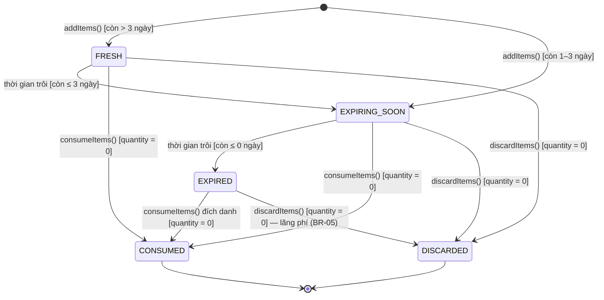

# Module `fridge` — UC-FRIDGE-01/02/03 · FR-08, FR-09, FR-11, FR-12, FR-13 · BR-01 → BR-06

Kho thực phẩm của gia đình: nhập (thủ công hoặc từ "Hoàn tất chuyến đi chợ"), tra cứu, ghi nhận sử
dụng theo **FEFO**, huỷ (lãng phí), sửa hạn dùng. Mọi thay đổi số lượng ghi `inventory_transactions`.

## Thành phần

| Lớp                              | Loại                 | Vai trò                                                                                           |
| -------------------------------- | -------------------- | ------------------------------------------------------------------------------------------------- |
| `FridgeController`               | boundary             | `/api/fridge/*`                                                                                   |
| `FridgeRealtimeListener`         | boundary (realtime)  | `FRIDGE_*` → `fridge:items-changed` tới room gia đình                                             |
| `FridgeService`                  | control              | `addItems`, `addManualItems`, `search`, `getDetail`, `updateItem`, `consumeItems`, `discardItems` |
| `StockDeductionStrategy`         | interface (Strategy) | chọn lô để trừ kho; token DI `STOCK_DEDUCTION_STRATEGY`                                           |
| `FefoDeductionStrategy`          | strategy             | FEFO trên lô còn hạn, quy đổi đơn vị cùng nhóm (hàm thuần)                                        |
| `FridgeItemRepository`           | repository           | `search`, `lockForDeduction`, `lockByIds`, `findMergeTarget` (`FOR UPDATE`)                       |
| `InventoryTransactionRepository` | repository           | `record` (chỉ thêm), `findByFridgeItem`                                                           |
| `FridgeItem`                     | entity               | `getState(today, lastType)`, `decrease()`, `increase()`, `daysUntilExpiry()`                      |
| `InventoryTransaction`           | entity               | ADD / CONSUME / DISCARD / ADJUST                                                                  |
| `BusinessClock` (common)         | tiện ích             | "hôm nay" theo `APP_TIMEZONE`                                                                     |

Phụ thuộc: `fridge → master-data` (CatalogItemResolver, CategoriesService, UnitsService). Không phụ
thuộc `shopping` — shopping gọi xuống `FridgeService.addItems()`.

## Endpoint

| Method | Path                    | Ai         | Ghi chú / lỗi nghiệp vụ chính                                                                                   |
| ------ | ----------------------- | ---------- | --------------------------------------------------------------------------------------------------------------- |
| GET    | `/api/fridge/items`     | thành viên | `?q&categoryId&foodId&storageLocation&state&page&pageSize` — chỉ lô còn hàng                                    |
| GET    | `/api/fridge/items/:id` | thành viên | kèm `transactions` (kể cả lô đã hết) · 404 khác gia đình                                                        |
| POST   | `/api/fridge/items`     | nội trợ    | `{ items: [{ foodId? \| name+categoryId, quantity, unitId, expiryDate?, storageLocation?, purchasedPrice? }] }` |
| PATCH  | `/api/fridge/items/:id` | nội trợ    | `{ expiryDate?, storageLocation?, purchasedPrice? }`                                                            |
| POST   | `/api/fridge/consume`   | nội trợ    | `{ items: [{ fridgeItemId \| foodId+unitId, quantity, unitId? }] }` · 409 `FRIDGE_INSUFFICIENT_STOCK`           |
| POST   | `/api/fridge/discard`   | nội trợ    | `{ items: [{ fridgeItemId, quantity? }] }` (không gửi = huỷ hết)                                                |

## Quy tắc

- **BR-01** trạng thái **tính ra**, không lưu: còn ≤ 0 ngày → `EXPIRED`; 1–3 ngày → `EXPIRING_SOON`;
  > 3 → `FRESH`; hết hàng → `CONSUMED`/`DISCARDED` theo giao dịch cuối. Lọc `state` ở tìm kiếm dịch
  > thành khoảng ngày: `EXPIRED: expiry ≤ hôm nay`, `EXPIRING_SOON: hôm nay < expiry ≤ hôm nay+3`,
  > `FRESH: expiry > hôm nay+3`.
- **BR-02** hạn mặc định = hôm nay + `categories.default_shelf_life_days`; hạn người dùng gửi phải
  ≥ hôm nay. Vị trí mặc định `FRIDGE`.
- **Gộp lô**: lô mới trùng (cùng `food_id` — hoặc cùng tên khi `food_id` NULL —, đơn vị, hạn, vị trí)
  và lô cũ còn hàng → cộng dồn số lượng và giá; vẫn ghi một giao dịch ADD cho mỗi dòng nhập.
- **BR-03 FEFO**: trừ theo thực phẩm chỉ dùng lô **còn hạn** (quyết định B7), hạn sớm trước, cùng hạn
  thì lô nhập trước; quy đổi g↔kg, ml↔l (BR-04); khác nhóm đơn vị bị bỏ qua. Trừ đích danh một lô
  (`fridgeItemId`) được cả lô hết hạn. Không đủ → 409 `FRIDGE_INSUFFICIENT_STOCK`
  `details = { line, foodId, requested, available, unitId, unitSymbol }`; cả yêu cầu bị huỷ (tất cả
  hoặc không). Đơn vị khác nhóm với lô chọn đích danh → 422 `UNIT_INCOMPATIBLE`.
- **BR-05** huỷ ghi `DISCARD` = lãng phí (FR-23). Lô đã hết hàng → 409.
- **Khoá**: mọi thay đổi khoá các lô liên quan bằng `FOR UPDATE`, theo thứ tự `id` (không deadlock).
- **BR-06**: lô của gia đình khác → 404; FEFO chỉ thấy lô của gia đình mình.
- Lô không bao giờ bị xoá (giữ lịch sử giao dịch cho báo cáo); lô hết hàng ẩn khỏi tìm kiếm.

## Máy trạng thái FridgeItem (tính ra từ `expiry_date`, `quantity`, giao dịch cuối)



Không lưu cột trạng thái: `FridgeItem.getState(today, lastTransactionType)` tính mỗi lần đọc.
`updateItem()` (sửa hạn) có thể đưa lô về FRESH/EXPIRING_SOON. Trừ một phần không đổi trạng thái.

## Sự kiện

| Domain event             | Payload                     | Realtime                                                         |
| ------------------------ | --------------------------- | ---------------------------------------------------------------- |
| `FRIDGE_ITEMS_ADDED`     | `FridgeItemsAddedEvent`     | `fridge:items-changed { reason:'added', source, fridgeItemIds }` |
| `FRIDGE_ITEMS_CONSUMED`  | `FridgeItemsConsumedEvent`  | `fridge:items-changed { reason:'consumed' }`                     |
| `FRIDGE_ITEMS_DISCARDED` | `FridgeItemsDiscardedEvent` | `fridge:items-changed { reason:'discarded' }`                    |
| `FRIDGE_ITEM_UPDATED`    | `FridgeItemUpdatedEvent`    | `fridge:items-changed { reason:'updated' }`                      |

Payload realtime chỉ có id: màn hình kho có lọc/phân trang nên app tải lại trang hiện tại qua REST.
`StockChange[]` trong sự kiện CONSUMED/DISCARDED dành cho báo cáo (B8+).

## Luồng gọi — ghi nhận sử dụng (sequence diagram)

```
App(Nội trợ) → FridgeController.consume(ConsumeItemsDto)
  → FridgeService.consumeItems(familyId, userId, dto)
      → validateConsumeLines   (đúng một trong fridgeItemId/foodId; foodId cần unitId)
      [transaction]
      → FridgeItemRepository.lockForDeduction(familyId, lotIds, foodIds)   FOR UPDATE, theo id
      → UnitsService.findMany(units)
      → mỗi dòng:
          ├─ fridgeItemId → UnitConverter.convert → FridgeItem.decrease(q)
          └─ foodId      → FefoDeductionStrategy.allocate(lots, {q, unit}, today)
                            → [{lotId, q}] → FridgeItem.decrease(q) × n
                            └─ không đủ → InsufficientStockException → rollback
      → FridgeItemRepository.save(lots) → InventoryTransactionRepository.record(CONSUME × lô)
      [commit]
      → emit(FRIDGE_ITEMS_CONSUMED) → FridgeRealtimeListener → fridge:items-changed
  ← 200 { data: [{ fridgeItemId, quantity, remaining, state }] }
```

Nhập kho từ chuyến đi chợ: xem `modules/shopping/README.md` (5.1 bước 5–8).

## Kiểm thử

- `strategies/stock-deduction.strategy.spec.ts`: FEFO, FIFO khi cùng hạn, biên hạn (−1/0/1 ngày),
  BVA số lượng (tổng − 0.001 / = tổng / + 0.001), quy đổi đơn vị, bỏ lô khác nhóm.
- `fridge.service.spec.ts`: hạn mặc định, gộp lô, tham gia transaction của người gọi, BVA tồn kho,
  EP dòng consume, huỷ, 404 khác gia đình. Coverage service ≥ 80%.
- e2e `test/shopping-fridge.e2e-spec.ts`: tìm không dấu, FEFO bỏ lô hết hạn, không đủ hàng không trừ
  gì, huỷ → DISCARDED, gia đình B không thấy/không trừ được.
