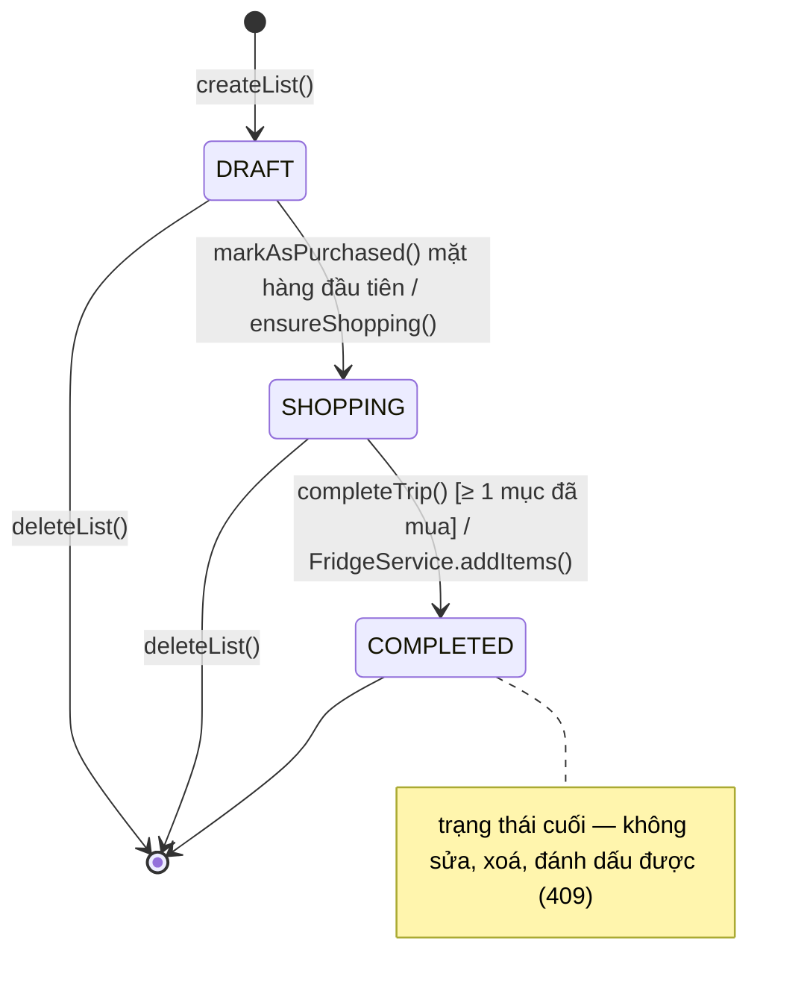
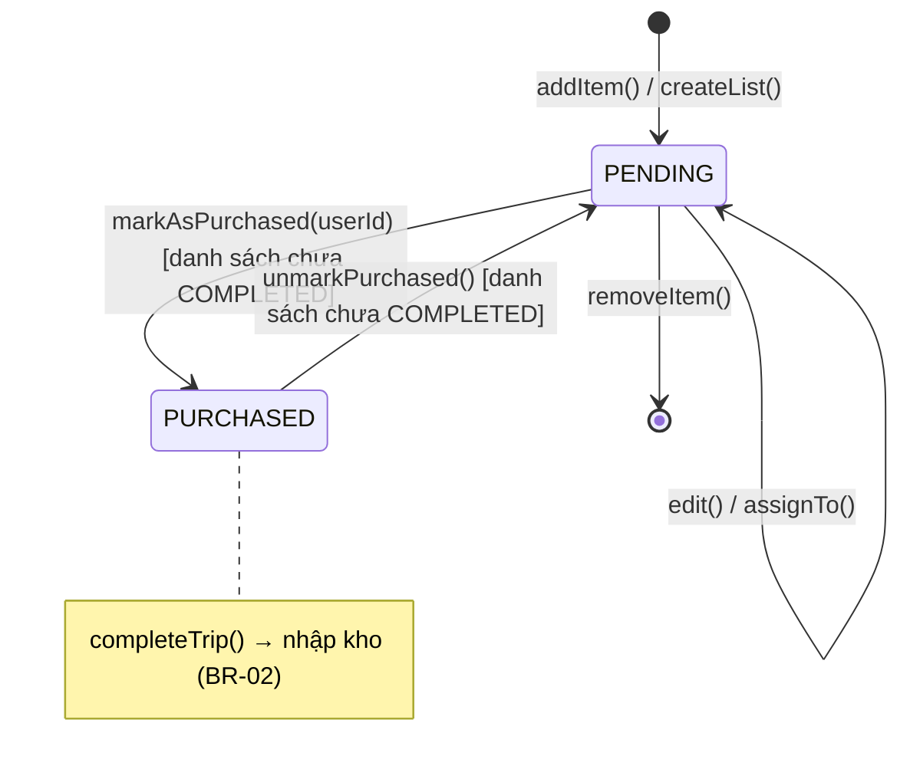

# Module `shopping` — UC-SHOP-01/02/03 · FR-03 → FR-08 · BR-02, BR-04, BR-06

Danh sách mua sắm của gia đình: lập danh sách theo ngày/tuần, phân công, đánh dấu "đã mua" thời
gian thực, **hoàn tất chuyến đi chợ → tự nhập kho** (luồng 5.1). Đây là module mẫu cho các module
sau (B8+): cùng cấu trúc thư mục, cách khoá, cách phát sự kiện, cách viết test.

## Thành phần (ánh xạ lớp phân tích — §10)

| Lớp                                 | Loại                | Vai trò                                                                              |
| ----------------------------------- | ------------------- | ------------------------------------------------------------------------------------ |
| `ShoppingController`                | boundary (REST)     | `/api/shopping-lists/*`, `@RequireFamily`, `@Roles(HOMEMAKER)` cho thao tác lập/sửa  |
| `ShoppingGateway`                   | boundary (realtime) | `@OnEvent(SHOPPING_*)` → `RealtimeService.emitToFamily` tới room `family:{id}`       |
| `ShoppingService`                   | control             | nghiệp vụ, transaction + khoá dòng, khoá lạc quan, phát sự kiện domain               |
| `FridgeService` (module `fridge`)   | control             | `addItems()` — nhập kho trong cùng transaction của `completeTrip` (BR-02)            |
| `CatalogItemResolver` (master-data) | control             | kiểm tra thực phẩm/danh mục/đơn vị (BR-04), tự gắn `food_id` cho tên trùng tên chuẩn |
| `ShoppingListRepository`            | repository          | `findInFamily`, `lockInFamily` (`FOR UPDATE`), `listForFamily`                       |
| `ShoppingListItemRepository`        | repository          | `findByList`, `lockInList`, `findPurchased`, `countByLists`                          |
| `ShoppingList`, `ShoppingListItem`  | entity              | máy trạng thái: `startShopping`, `ensureShopping`, `complete`, `markAsPurchased`, …  |
| `events.ts`                         | sự kiện domain      | 7 hằng số + class payload (bên dưới)                                                 |
| `@dctl/shared` `shopping-events`    | sự kiện realtime    | tên sự kiện + kiểu payload dùng chung với app mobile                                 |

Phụ thuộc chỉ đi xuống: `shopping → fridge → master-data`, `shopping → users`. Không module nào
import `shopping` (B9 `meal-plan`/`ai` sẽ dùng `ShoppingService.addItem` cho FR-16).

## Endpoint

| Method | Path                                                   | Ai         | Ghi chú / lỗi nghiệp vụ chính                                                         |
| ------ | ------------------------------------------------------ | ---------- | ------------------------------------------------------------------------------------- |
| POST   | `/api/shopping-lists`                                  | nội trợ    | `{ targetDate, periodType?, items? }` · 400 ngày đã qua                               |
| GET    | `/api/shopping-lists?status&from&to&page&pageSize`     | thành viên | `{ data, meta }`, ngày mới nhất trước                                                 |
| GET    | `/api/shopping-lists/:listId`                          | thành viên | kèm `items` gom theo danh mục (FR-05) · 404 khác gia đình                             |
| PATCH  | `/api/shopping-lists/:listId`                          | nội trợ    | đổi `targetDate`/`periodType` · 409 đã hoàn tất                                       |
| DELETE | `/api/shopping-lists/:listId`                          | nội trợ    | 204 · 409 đã hoàn tất (lịch sử FR-21)                                                 |
| POST   | `/api/shopping-lists/:listId/items`                    | nội trợ    | `{ foodId? \| itemName+categoryId, expectedQuantity, unitId, assigneeId? }`           |
| PATCH  | `/api/shopping-lists/:listId/items/:itemId`            | nội trợ    | `{ version, … }` · 409 `VERSION_CONFLICT` / đã mua                                    |
| DELETE | `/api/shopping-lists/:listId/items/:itemId`            | nội trợ    | 204 · 409 nếu đã mua                                                                  |
| PUT    | `/api/shopping-lists/:listId/items/:itemId/assignee`   | nội trợ    | `{ version, assigneeId \| null }` · 404 `FAMILY_MEMBER_NOT_FOUND`                     |
| POST   | `/api/shopping-lists/:listId/items/:itemId/purchase`   | thành viên | `{ version }` — "đã mua" một chạm (FR-07)                                             |
| POST   | `/api/shopping-lists/:listId/items/:itemId/unpurchase` | thành viên | `{ version }` — hoàn tác khi bấm nhầm                                                 |
| POST   | `/api/shopping-lists/:listId/complete`                 | thành viên | `{ items?: [{ itemId, quantity?, expiryDate?, storageLocation?, purchasedPrice? }] }` |

"Nội trợ" = `@Roles(HOMEMAKER)`; "thành viên" = mọi người trong gia đình (kể cả nội trợ).
Quyết định B7: phân quyền đúng actor UC — UC-SHOP-01 của nội trợ; UC-SHOP-02/03 của mọi thành viên.

## Quy tắc

- **BR-06**: `familyId` lấy từ `@CurrentFamilyId()`; mọi truy vấn lọc theo nó. Id của gia đình khác
  → 404 (không lộ thông tin). Gửi `familyId` trong body → 400 (`forbidNonWhitelisted`).
- **BR-04**: mặt hàng chọn `foodId` (APPROVED hoặc PENDING của chính gia đình) hoặc tên tự do + danh
  mục. Tên tự do trùng tên chuẩn → tự gắn `food_id`. Tên mới không tự tạo `foods` (app gọi
  `POST /api/foods/contribute` của B5 nếu muốn đề xuất).
- **Ngày đi chợ (FR-04)**: DAY → `targetDate ≥ hôm nay`; WEEK → tuần `targetDate … +6` chưa kết thúc.
- **Khoá**: mọi thay đổi chạy trong transaction, khoá `shopping_lists` (`FOR UPDATE`) **rồi** mới
  tới `shopping_list_items` → "đã mua" và "hoàn tất" không chồng nhau, không deadlock.
- **Khoá lạc quan (NFR §9)**: mỗi mặt hàng có `version` (`@VersionColumn`, tăng mỗi lần lưu). Client
  gửi `version` đã đọc; khác → 409 `VERSION_CONFLICT`,
  `details = { expectedVersion, currentVersion, current: <mặt hàng mới nhất> }` để app cập nhật
  ngay không cần tải lại. Hai người bấm "đã mua" cùng lúc → một 200, một 409 (có e2e).
- **BR-02**: hoàn tất chỉ nhập mặt hàng `is_purchased = true`; hạn dùng mặc định
  `hôm nay + categories.default_shelf_life_days`, người dùng sửa được (`expiryDate` ≥ hôm nay);
  vị trí mặc định `FRIDGE`; chưa mua gì → 409 `SHOPPING_NOTHING_PURCHASED`. Mặt hàng chưa mua
  giữ lại trong danh sách đã hoàn tất làm lịch sử.
- Danh sách `COMPLETED` không sửa/xoá/đánh dấu được nữa → 409 `INVALID_STATE_TRANSITION`.

## Máy trạng thái (để vẽ state diagram)

**ShoppingList** — cột `status`, bảng chuyển `SHOPPING_LIST_TRANSITIONS`:



Chuyển không hợp lệ (vd `complete()` từ DRAFT, mọi thao tác trên COMPLETED) → 409
`INVALID_STATE_TRANSITION`. Không có SHOPPING → DRAFT: hoàn tác hết "đã mua" thì danh sách vẫn ở
SHOPPING. DRAFT gọi hoàn tất → 409 `SHOPPING_NOTHING_PURCHASED` (chưa mua gì).

**ShoppingListItem** — suy ra từ `is_purchased`, bảng chuyển `SHOPPING_LIST_ITEM_TRANSITIONS`:



`edit()`, `assignTo()`, `removeItem()` chỉ ở PENDING. `PURCHASED → PENDING` (hoàn tác) là bổ sung
của B7 so với §10 (ghi ở §14).

## Sự kiện

| Domain event (`events.ts`) | Payload class                | Realtime (`REALTIME_EVENTS.*`)               | Khi nào                                                               |
| -------------------------- | ---------------------------- | -------------------------------------------- | --------------------------------------------------------------------- |
| `SHOPPING_LIST_CREATED`    | `ShoppingListChangedEvent`   | `shopping:list-created` `{ list, actorId }`  | lập danh sách (5.1 bước 2 — FR-06)                                    |
| `SHOPPING_LIST_UPDATED`    | `ShoppingListChangedEvent`   | `shopping:list-updated`                      | đổi ngày/kỳ; DRAFT → SHOPPING                                         |
| `SHOPPING_LIST_DELETED`    | `ShoppingListDeletedEvent`   | `shopping:list-deleted` `{ listId }`         | xoá danh sách                                                         |
| `SHOPPING_ITEM_ADDED`      | `ShoppingItemAddedEvent`     | `shopping:item-added` `{ item }`             | thêm mặt hàng                                                         |
| `SHOPPING_ITEM_UPDATED`    | `ShoppingItemUpdatedEvent`   | `shopping:item-updated` `{ item, change }`   | `change` = `edited`/`assigned`/`purchased`/`unpurchased` (5.1 bước 4) |
| `SHOPPING_ITEM_REMOVED`    | `ShoppingItemRemovedEvent`   | `shopping:item-removed` `{ listId, itemId }` | xoá mặt hàng                                                          |
| `SHOPPING_TRIP_COMPLETED`  | `ShoppingTripCompletedEvent` | `shopping:trip-completed`                    | hoàn tất + đã nhập kho (5.1 bước 8)                                   |

- Domain event phát **sau commit**, mang snapshot đã commit (`list` / `item` cùng dạng response REST).
- Mọi payload realtime có `actorId`; app bỏ qua thay đổi do chính mình (đã cập nhật từ response REST).
- `ShoppingItemUpdatedEvent.previousAssigneeId` dành cho B8 (thông báo người được phân công — FR-03).
- Hoàn tất còn phát `FRIDGE_ITEMS_ADDED` (module fridge) → `fridge:items-changed { reason: 'added', source: 'shopping-trip' }`.
- Gia đình khác **không** nhận gì (e2e kiểm tra). Mất kết nối → app tải lại qua REST.

## Luồng gọi (để vẽ sequence diagram)

**5.1 bước 1–2 — Lập danh sách**

```
App(Nội trợ) → ShoppingController.create(CreateShoppingListDto)
  [JwtAuthGuard → RolesGuard(HOMEMAKER) → FamilyMemberGuard → ValidationPipe]
  → ShoppingService.createList(familyId, userId, dto)
      → assertTargetDate (BR: không trước hôm nay)
      → CatalogItemResolver.resolve(familyId, items)        (BR-04: food/category/unit)
      → UserRepository.findBy(assignees ∈ family)            (BR-06)
      [transaction] ShoppingListRepository.save(DRAFT) → ShoppingListItemRepository.save(items)
      → getList() → ShoppingListDetailResponse
      → EventEmitter2.emit(SHOPPING_LIST_CREATED)
           └─▶ ShoppingGateway.onListCreated → RealtimeService.emitToFamily
                 → Redis adapter → socket mọi thành viên: shopping:list-created
  ← 201 { data: list + items }
```

**5.1 bước 3–4 — Đánh dấu "Đã mua"**

```
App(Thành viên) → ShoppingController.purchase(listId, itemId, { version })
  → ShoppingService.markAsPurchased(familyId, userId, listId, itemId, dto)
      [transaction]
      → ShoppingListRepository.lockInFamily(listId, familyId)   SELECT … FOR UPDATE  (404 khác GĐ)
      → ShoppingList.assertEditable()                           (409 nếu COMPLETED)
      → ShoppingListItemRepository.lockInList(itemId, listId)   SELECT … FOR UPDATE
      → assertVersion(item, dto.version)                        (409 VERSION_CONFLICT + current)
      → ShoppingListItem.markAsPurchased(userId, now)           PENDING → PURCHASED
      → ShoppingListItemRepository.save(item)                   version + 1
      → ShoppingList.ensureShopping()  [mục đầu tiên] DRAFT → SHOPPING → save(list)
      [commit]
      → emit(SHOPPING_ITEM_UPDATED, change='purchased')  → ShoppingGateway → shopping:item-updated
      → [nếu vừa đổi] emit(SHOPPING_LIST_UPDATED)        → ShoppingGateway → shopping:list-updated
  ← 200 { data: item (version mới) }
```

**5.1 bước 5–8 — Hoàn tất chuyến đi chợ → nhập kho** (một transaction — quyết định B7)

```
App(Thành viên) → ShoppingController.complete(listId, CompleteTripDto{items?: overrides})
  → ShoppingService.completeTrip(familyId, userId, listId, dto)
      → assertOverrideDates (expiryDate ≥ hôm nay)
      [transaction (manager)]
      → ShoppingListRepository.lockInFamily → ShoppingList.assertEditable()
      → ShoppingListItemRepository.findPurchased(listId)        bước 6: quét mục PURCHASED (BR-02)
          └─ rỗng → 409 SHOPPING_NOTHING_PURCHASED
      → kiểm tra overrides thuộc các mục đã mua (400)
      → ShoppingList.complete()                                 SHOPPING → COMPLETED
      → map mục đã mua → FridgeItemInput[]                       bước 7: chuyển đổi
      → FridgeService.addItems(inputs, { familyId, actorId, source:'shopping-trip', manager })
          → CategoriesService.findMany → hạn mặc định = hôm nay + default_shelf_life_days
          → FridgeItemRepository.findMergeTarget (FOR UPDATE) → increase() | create()
          → FridgeItemRepository.save(lots)
          → InventoryTransactionRepository.record(ADD × n)
          ← { lots, event }   (không phát sự kiện — người gọi phát sau commit)
      → ShoppingListRepository.save(list)
      [commit — lỗi ở bất kỳ bước nào → rollback toàn bộ: không hoàn tất, không nhập kho]
      → FridgeService.publishItemsAdded(result) → FridgeRealtimeListener → fridge:items-changed
      → emit(SHOPPING_TRIP_COMPLETED) → ShoppingGateway → shopping:trip-completed
  ← 200 { data: { list, importedItemIds, fridgeItemIds, pendingItemCount } }   bước 8
```

**Xung đột khi hai người cùng sửa** (alt fragment cho sequence diagram)

```
A: GET list (item v3) ─┐                     B: GET list (item v3)
A: purchase{v3} ───────┼─▶ lock list → v3 = v3 ✓ → save v4 → 200
                       │   B: purchase{v3} chờ khoá list … → v4 ≠ v3 → 409 VERSION_CONFLICT{current v4}
B: áp dụng details.current (hoặc sự kiện shopping:item-updated) → hiển thị "đã mua" bởi A
```

## Kiểm thử

- Unit (`shopping.service.spec.ts`, `entities/*.spec.ts`, `shopping.gateway.spec.ts`): EP vai trò
  thay đổi mặt hàng, BVA ngày đi chợ (DAY −1/0, WEEK −6/−7), version cũ, máy trạng thái, hoàn tất
  chỉ nhập mục đã mua, rollback khi kho lỗi. Coverage service ≥ 80% (ngưỡng trong `jest.config.json`).
- e2e (`test/shopping-fridge.e2e-spec.ts`): luồng 5.1 qua API → DB → socket của 2 thành viên;
  gia đình B không nhận gì; hai người cùng "đã mua" → 200 + 409.
